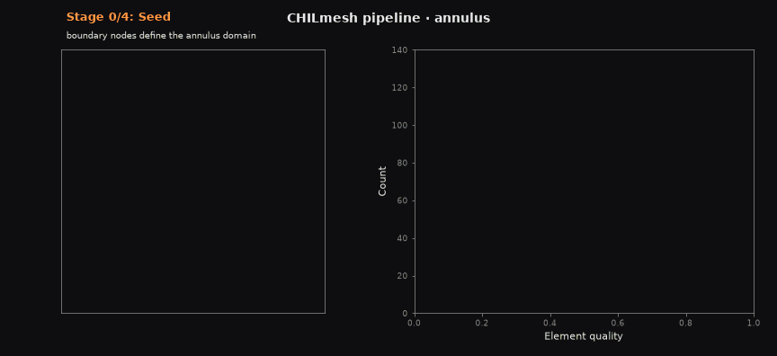

<p align="center">
  
</p>

<h1 align="center">CHILmesh</h1>

<p align="center">
  <strong>2D mesh I/O, layer peel, smoothing, and quality analysis for triangular, quadrilateral, and mixed-element hydrodynamic meshes; C++ backend 8.6× to 14.7× faster than Python on full init.</strong>
</p>

<p align="center">
  <strong><a href="https://scholar.google.com/citations?user=IBFSkOcAAAAJ&hl=en">Dominik Mattioli</a><sup>1†</sup>, <a href="https://scholar.google.com/citations?user=mYPzjIwAAAAJ&hl=en">Ethan Kubatko</a><sup>2</sup></strong><br>
  <sup>†</sup>Corresponding author | <sup>1</sup>Unaffiliated | <sup>2</sup>Ohio State University (<a href="https://ceg.osu.edu/computational-hydrodynamics-and-informatics-laboratory"></a>)
</p>

<p align="center">
    <a href="https://pypi.org/project/chilmesh/"></a>
    <a href="https://www.python.org/downloads/"></a>
    <a href="https://github.com/domattioli/CHILmesh/actions/workflows/python-package.yml"></a>
    <a href="https://github.com/domattioli/CHILmesh/issues"></a>
  <a href="https://doi.org/10.5281/zenodo.20263853"></a>
    <a href="https://github.com/domattioli/CHILmesh/blob/main/LICENSE"></a>
</p>

> **MATLAB users.** The Python library succeeds the original MATLAB code, which is no longer maintained ([`src/@CHILmesh/CHILmesh.m`](src/@CHILmesh/CHILmesh.m)). Run `pip install chilmesh` and call it through the `py.` bridge, for example `py.chilmesh.Mesh.read_from_fort14('ocean.14')`.

> **Python 3.10 support ends in the next release.** Python 3.10 reaches end of life in October 2026. The next CHILmesh release will require Python 3.11 or newer; 1.6.x stays installable on 3.10.

## Table of Contents

1. [Status & Roadmap](#1-status--roadmap)
2. [Installation](#2-installation)
3. [Quick start](#3-quick-start)
4. [Fetching meshes from Valence](#4-fetching-meshes-from-valence)
5. [Examples and CLI](#5-examples-and-cli)
6. [Limitations](#6-limitations)
7. [Documentation](#7-documentation)
8. [Citation](#8-citation)
9. [Contributing](#9-contributing)
10. [License](#10-license)

## 1. Status & Roadmap

**Current release: 1.6.0 (2026-10-12); see [CHANGELOG](CHANGELOG.md).** The v1.x API is stable; downstream projects can pin `chilmesh>=1.0,<2`. CHILmesh reads and writes ADCIRC, SMS and Gmsh meshes, peels concentric element layers, smooths and measures quality on triangular, quadrilateral and mixed meshes, and offers an optional C++ backend. On the 531,680-element ENPAC2003 mesh, full initialization takes 1.44 s in C++ against 12.30 s in Python (8.6×; method in [`docs/BENCHMARK.md`](docs/BENCHMARK.md)).

- **Now:** dropping Python 3.10 (end of life October 2026); the next release requires Python 3.11+. A native `.chil` container format ([#201](https://github.com/domattioli/CHILmesh/issues/201)); ADCIRC hot-start files and byte-preserving fort.15 edits ([#289](https://github.com/domattioli/CHILmesh/issues/289)).
- **Next:** MCP server tools ([#286](https://github.com/domattioli/CHILmesh/issues/286)); a streaming GPU mesh view ([#167](https://github.com/domattioli/CHILmesh/issues/167)); a full-lifecycle benchmark on the STOFS-2D-Global mesh ([#276](https://github.com/domattioli/CHILmesh/issues/276)).
- **Later:** one ecosystem with <a href="https://github.com/domattioli/ADMESH"></a> and <a href="https://github.com/domattioli/QuADMESH"></a>.

<div align="right"><a href="#chilmesh"><sub>^ Back to top</sub></a></div>

## 2. Installation

```bash
pip install chilmesh             # PyPI, pure Python
pip install "chilmesh[cpp]"      # adds the prebuilt C++ backend
pip install "chilmesh[gpu]"      # adds the experimental GPU renderer
pip install "chilmesh[netcdf]"   # adds netCDF4 for read_adcirc_output_nc
pip install "chilmesh[partition]" # adds pymetis for partition_mesh(method="metis")
```

Python 3.10 or newer. Prebuilt C++ wheels cover Linux x86_64, macOS (x86_64, arm64) and Windows x86_64; other platforms build from source (`pip install ./src/chilmesh_cpp`, needs a C++ toolchain and CMake). Check with `chilmesh.backend_info()`. Backend details: [`docs/ARCHITECTURE.md`](docs/ARCHITECTURE.md).

**File formats**

| Format | Read | Write |
|---|---|---|
| ADCIRC fort.14 mesh | `Mesh.read_from_fort14`, `read_fort14_raw` | `Mesh.write_to_fort14`, `write_fort14_raw` |
| ADCIRC fort.13 / fort.15 | `read_fort13`, `read_fort15` | `write_fort13`, `write_fort15` |
| ADCIRC output fort.61/62/63/64, maxele.63, maxvel.63 | `read_adcirc_output` | none |
| ADCIRC NetCDF output (`.nc`) | `read_adcirc_output_nc` (needs `[netcdf]`) | none |
| ADCIRC fort.19 / fort.20 boundary forcing | `read_fort19`, `read_fort20` | `write_fort19`, `write_fort20` |
| ADCIRC fort.24 tidal potential | `read_fort24` | `write_fort24` |
| fort.22 best-track (ATCF) | `read_fort22_besttrack` | `write_fort22_besttrack` |
| OWI wind and pressure | `read_owi` | `write_owi` |
| SMS .2dm (with `NS` nodestrings) | `Mesh.read_from_2dm` | `Mesh.write_to_2dm` |
| Gmsh .msh | `Mesh.read_from_msh` | `write_msh` |

Also: `color_elements` / `check_coloring` (element coloring), `partition_mesh` / `partition_report` (element partitioning), and `chilplotting.plot_field` (nodal results on the mesh).

<div align="right"><a href="#chilmesh"><sub>^ Back to top</sub></a></div>

## 3. Quick start

```python
import numpy as np
from chilmesh import Mesh

mesh = Mesh.read_from_fort14("ocean.14")          # ADCIRC grid, boundaries preserved
mesh.smooth_mesh(method="fem", acknowledge_change=True)
quality, angles, stats = mesh.elem_quality()      # per-element skew quality
elem = mesh.find_element(np.array([-75.2, 35.1]))  # O(log n) point location
mesh.write_to_fort14("ocean_smoothed.14")
```

<div align="right"><a href="#chilmesh"><sub>^ Back to top</sub></a></div>

## 4. Fetching meshes from Valence

The `chilmesh.registry` module ships since 1.5.5. Meshes come through Valence, a token-gated mesh service. Sign in with GitHub at https://valence-api.iqh766c2.workers.dev. A GitHub account at least 30 days old gets a token at once; it is shown once. A token allows 500 downloads per day (the count resets at midnight UTC) and expires after one year.

```bash
export VALENCE_TOKEN=<your token>
python - <<'EOF'
from chilmesh import registry
names = registry.list_meshes()
mesh = registry.fetch_mesh("Block_O.14")
EOF
```

Error classes and options: [`docs/API.md`](docs/API.md).

<div align="right"><a href="#chilmesh"><sub>^ Back to top</sub></a></div>

## 5. Examples and CLI

Run `python examples/01_quickstart.py` (four scripts in [`examples/`](examples/)), or use the CLI: `chilmesh info|summary|convert|smooth|plot` (`python -m chilmesh` is equivalent; every subcommand takes `--help`).

<div align="right"><a href="#chilmesh"><sub>^ Back to top</sub></a></div>

## 6. Limitations

- **Two-dimensional only.** Vertices carry a z value, but topology, quality and smoothing operate in the plane.
- **A plain install runs at Python speed.** Add the `[cpp]` extra for the C++ backend.
- **The GPU renderer is experimental**, and Rust is frozen ([`docs/RUST_EVALUATION.md`](docs/RUST_EVALUATION.md)).
- **Smoothing does not change topology**, and the size function can trade worst-element quality for size accuracy; further caveats are in [`docs/CONCEPTS.md`](docs/CONCEPTS.md).
- **Benchmarks are single-machine medians of three runs.** Ratios between backends are the reproducible quantity.

<div align="right"><a href="#chilmesh"><sub>^ Back to top</sub></a></div>

## 7. Documentation

- [`docs/API.md`](docs/API.md): API reference, capabilities table, registry errors
- [`docs/ARCHITECTURE.md`](docs/ARCHITECTURE.md): adjacency tables, backends
- [`docs/BENCHMARK.md`](docs/BENCHMARK.md): benchmark method, tables, figures
- [`docs/CONCEPTS.md`](docs/CONCEPTS.md): layers, medial axis, skeleton; extra limitations
- [`tests/TESTING.md`](tests/TESTING.md): pytest markers and parity tests

<div align="right"><a href="#chilmesh"><sub>^ Back to top</sub></a></div>

## 8. Citation

[](https://doi.org/10.5281/zenodo.20263853) [](https://github.com/user-attachments/files/19727573/QuADMESH__Thesis_Doc.pdf)

```bibtex
@software{mattioli_chilmesh,
  author = {Mattioli, Dominik O. and Kubatko, Ethan J.},
  title = {{CHILmesh}: a fast 2D mesh library for triangular, quadrilateral, and mixed-element grids},
  year = {2026}, publisher = {Zenodo}, version = {1.5.0},
  doi = {10.5281/zenodo.20263853}, url = {https://github.com/domattioli/CHILmesh}
}
@mastersthesis{mattioli2017quadmesh,
  author = {Mattioli, Dominik O.},
  title = {{QuADMESH+}: A Quadrangular ADvanced Mesh Generator for Hydrodynamic Models},
  school = {The Ohio State University}, year = {2017},
  url = {http://rave.ohiolink.edu/etdc/view?acc_num=osu1500627779532088}
}
```

The concept DOI above always resolves to the latest release. To cite version 1.5.0 exactly, use [10.5281/zenodo.23096013](https://doi.org/10.5281/zenodo.23096013). CHILmesh is a by-product of a project funded by Aquaveo at The Ohio State University in 2015-2017.

<div align="right"><a href="#chilmesh"><sub>^ Back to top</sub></a></div>

## 9. Contributing

Issues and pull requests at [github.com/domattioli/CHILmesh](https://github.com/domattioli/CHILmesh). Run `pytest -v` before opening a PR; markers and backend setup are in [`tests/TESTING.md`](tests/TESTING.md).

<div align="right"><a href="#chilmesh"><sub>^ Back to top</sub></a></div>

## 10. License

**Noncommercial and research use only.** PolyForm Noncommercial License 1.0.0 with an additional No-AI/ML-training restriction; see [LICENSE](LICENSE) and [docs/AI-USAGE.md](docs/AI-USAGE.md). Commercial use, and use as training, fine-tuning or evaluation data for any model, require a separate written license from [github.com/domattioli](https://github.com/domattioli).
