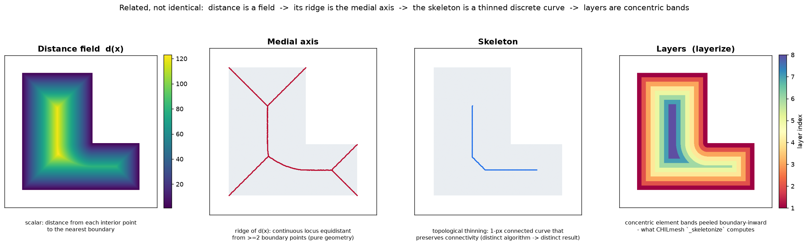

# CHILmesh Performance Benchmarks

The C++ backend full-initializes the 531,680-element ENPAC2003 mesh in 1.44 s against 12.30 s in Python, an 8.6× speedup. Every number below regenerates from the committed harness. Absolute times are machine-dependent.

**Version:** 1.2.2
**Headline reference mesh:** EasternPacific_ENPAC2003 (272,913 vertices, 531,680 elements, 804,728 edges, 75 layers). It is a continental-scale ADCIRC mesh; meshes come through Valence (see `chilmesh.registry`).
**Parity reference mesh:** WNAT_Hagen (52,774 vertices, 98,365 elements, 151,248 edges, 30 layers). It is the historical cross-language baseline.

## Contents

1. Reproduce the numbers
2. Headline results and figures
3. Cross-language at continental scale (v1.2.2)
4. ENPAC2003 pipeline and quality
5. Cross-backend layer parity
6. Cross-language on WNAT_Hagen (v1.1.0)
7. Rust backend
8. Mesh lifecycle, heavy meshes and real-world meshes
9. Size-weighted smoothing
10. Historical results (pre-1.1.0)

## 1. Reproduce the numbers

Run the committed harness:

1. Run `python scripts/benchmark.py --matlab`.
2. For the Octave column, put `octave` on PATH.
3. For the C++ column, run `pip install "chilmesh[cpp]"` (prebuilt wheel) or `pip install ./src/chilmesh_cpp` (source build).

The harness asserts `n_layers` parity across all available implementations. Stale hand-entered figures cannot creep back in.

Section-specific commands appear beside their tables.

## 2. Headline results and figures

On the 531,680-element ENPAC2003 mesh, C++ full init takes 1.44 s and Python takes 12.30 s, an 8.6× speedup. On the 98,365-element WNAT_Hagen mesh the ratio is 14.7× (1.65 s → 0.112 s).

Reference workload: EasternPacific_ENPAC2003, 272,913 vertices, 531,680 elements, 75 layers, available through Valence. The medians come from 3 runs on one machine at chilmesh 1.2.2. The algorithms have not changed since. A 1.4.1 rerun on a second machine gave Python 11.89 s and C++ 0.803 s for full init (14.8×).

| Stage | MATLAB (Octave 8.4) | Python | C++ | Rust |
|---|---:|---:|---:|---:|
| Fast init (adjacency, no peel) | 2.738 s | 6.454 s | 0.769 s | not exposed |
| Peel only | 12.771 s | 5.814 s | 0.669 s | not exposed |
| Full init (adjacency + peel) | 16.677 s | 12.300 s | 1.438 s | 11.98 s † |
| Quality (signed area) | 75 ms | 51 ms | 7 ms | 2 ms † |

* Every backend runs the same operation on the same in-memory arrays. fort.14 parsing and rendering are excluded.
* All four backends resolve `n_layers = 75`. Python and C++ layers are bit-identical.
* Octave builds adjacency 2.4× faster than Python through `sparse()` accumulation.
* Python peels 2.2× faster than Octave.
* † Rust was measured at chilmesh 1.4.1 on the second machine. The same-machine controls were Python 11.89 s and C++ 0.803 s.

Method and raw data are in this document. The layer-parity catalog (557 to 273k vertices) is in section 5.

<p align="center">
  
  <br>
  <sub><em><strong>Figure 1.</strong> EasternPacific_ENPAC2003 (272,913 vertices, 531,680 elements). <code>plot_quality()</code> renders per-element skew quality; <code>plot_quality_histogram()</code> draws the matched-colormap distribution beneath. Reproduce with <code>python scripts/generate_enpac_showcase.py</code>.</em></sub>
</p>

<p align="center">
  
  <br>
  <sub><em><strong>Figure 2.</strong> Distance is a scalar field; its ridge is the medial axis; the skeleton is a thinned discrete curve; layers are the concentric element bands CHILmesh peels. Definitions and algorithms: <a href="CONCEPTS.md">CONCEPTS.md</a>. Reproduce with <code>python scripts/illustrate_mesh_concepts.py</code>.</em></sub>
</p>

---

## 3. Cross-language at continental scale (v1.2.2, EasternPacific_ENPAC2003, medians)

C++ leads every stage. Full init is 8.6× faster than Python and 11.6× faster than Octave.

Setup:

* The numbers are medians of three runs on a single machine at chilmesh 1.2.2.
* Command: `python scripts/benchmark.py --matlab --mesh EasternPacific_ENPAC2003.14 --max-elements 600000` (`octave` on PATH for the MATLAB column).
* The mesh (272,913 vertices, 531,680 elements, 804,728 edges) is ~5× WNAT_Hagen. It is the largest single-domain mesh profiled cross-language to date.

All three backends time the same operation on the same in-memory `(connectivity, points)` arrays. The timed operations are:

* `_build_adjacencies` (fast init)
* `_peel` (layer peel)
* the two combined (full init)
* `signed_area` (quality)

No backend reads the fort.14 file inside the timed region.

| Stage | MATLAB (Octave) | Python | C++ |
|---|---:|---:|---:|
| Fast init (adj, no skeletonization) | 2.738 s | 6.454 s | 0.769 s |
| Skeletonization only | 12.771 s | 5.814 s | 0.669 s |
| Full init (adj + skeletonization) | 16.677 s | 12.300 s | 1.438 s |
| Quality (signed area) | 75 ms | 51 ms | 7 ms |

Findings:

* `n_layers = 75` on all three backends (parity ✅). `tests/test_backend_equivalence.py` asserts the Python and C++ layers are bit-identical.
* Octave builds adjacency 2.4× faster than Python (2.738 s vs 6.454 s), because `sparse` and `sort` are compiled built-ins.
* Python skeletonization runs 2.2× faster than Octave (5.814 s vs 12.771 s).
* Python finishes full init ~26% ahead of Octave.
* Quality is signed area on every backend. Python (51 ms) edges out Octave (75 ms).
* An earlier 4.6× "Python slower" gap came from timing Python's skew metric against the other backends' signed area (#216, resolved).

---

## 4. ENPAC2003 pipeline and quality

### Full Python pipeline (parse → render)

Rendering dominates wall-clock at this scale; topology does not. The table includes I/O and rendering, which the cross-language table omits. Medians of 3, single machine, chilmesh 1.2.2.

| Stage | Time | Engine |
|---|---:|---|
| fort.14 parse | 2.11 s | file → arrays |
| Adjacency build | 5.26 s | `EdgeMap` hash, O(1) edge lookup |
| Layerize | 5.03 s | concentric layer peel → 75 layers |
| Spatial index | 0.29 s | `cKDTree` (vertex + centroid) |
| Quality (signed area) | 41 ms | over 531,680 elements |
| Render | 11.49 s | `plot()` → PNG; dominates wall-clock |

The timed compute stage is the layer peel (`_peel`). It is distinct from medial axis, skeleton and distance; see [`CONCEPTS.md`](CONCEPTS.md) and [#221](https://github.com/domattioli/CHILmesh/issues/221).

### Mesh quality

Element and connectivity quality on ENPAC2003 (531,680 mostly-triangular elements):

| Metric | Value | Call |
|---|---:|---|
| Angular skew, mean / min | 0.875 / 0.15 | `elem_quality()` |
| Min interior angle, worst / per-elem mean | 8.98° / 52.5° | `interior_angles()` |
| Aspect ratio, mean / min | 0.972 / 0.081 | `element_quality(metric='aspect_ratio')` |
| Irregular interior vertices (valence ≠ 6) | 3.9% | `adjacencies['Vert2Elem']` degree |
| Mean interior valence | 6.0 | - |

Skew and aspect ratio apply to triangles and quads. Valence regularity compares each interior vertex against its ideal degree (6 for triangles, 4 for quads). The irregular-vertex fraction therefore flags topological defects independent of geometry.

---

## 5. Cross-backend layer parity

All three backends produce identical `n_layers` (layerize) across the catalog, 557 to 273k vertices. Connectivity and points are identical inputs; only the layering is compared. Meshes come through Valence.

| Mesh | Vertices | Elements | MATLAB | Python | C++ | Match |
|---|--:|--:|--:|--:|--:|:--:|
| Baranja Hill (ADMESH v2) | 557 | 1,011 | 10 | 10 | 10 | ✅ |
| Baranja Hill | 645 | 1,193 | 12 | 12 | 12 | ✅ |
| Wetting/Drying test | 2,716 | 4,978 | 15 | 15 | 15 | ✅ |
| Lake Erie (refined) | 5,095 | 9,688 | 20 | 20 | 20 | ✅ |
| Lake Erie (5k) | 13,266 | 24,910 | 17 | 17 | 17 | ✅ |
| Delaware Bay | 14,449 | 26,698 | 17 | 17 | 17 | ✅ |
| Delaware Bay (h 100–20000) | 14,449 | 26,697 | 17 | 17 | 17 | ✅ |
| Lake Michigan | 21,981 | 41,887 | 25 | 25 | 25 | ✅ |
| Chesapeake Bay | 83,388 | 160,734 | 55 | 55 | 55 | ✅ |
| Great Lakes | 132,162 | 250,905 | 46 | 46 | 46 | ✅ |
| EasternPacific_ENPAC2003 | 272,913 | 531,680 | 75 | 75 | 75 | ✅ |

---

## 6. Cross-language on WNAT_Hagen (v1.1.0, single machine, medians)

C++ leads throughout. Python skeletonization now beats Octave; the remaining Python gap is the adjacency build (pure-Python loops).

| Stage | MATLAB (Octave) | Python | C++ |
|---|---:|---:|---:|
| Fast init (adj, no skeletonization) | 0.27 s | 1.31 s | 0.060 s |
| Skeletonization only | 0.67 s | 0.32 s | 0.052 s |
| Full init (adj + skeletonization) | 1.04 s | 1.65 s | 0.112 s |
| Quality analysis | 12 ms | 6.4 ms | 1.3 ms |

* `n_layers = 30` on all three (parity ✅).
* MATLAB is the original `src/@CHILmesh` class under GNU Octave 8.4 (interpreter, not MATLAB JIT).
* Rust is excluded from this WNAT table. It was measured separately on the bundled fixtures (section 7).
* Absolute times are machine-dependent.

---

## 7. Rust backend (measured 2026-07-14)

Rust is output-equivalent to Python but earns no performance niche over C++. #163 is closed, so the earlier "skeletonization incomplete" exclusion is stale.

On the bundled fixtures:

* Rust full-inits ~3–5× faster than Python.
* Rust is ~2–5× slower than C++ (≈5× behind on `Block_O`).

The `get_vertex_edges` query path was O(_n_) per call, 100–1800× slower than C++/Python, because it rebuilt the edge list every call. That defect is fixed:

* The vertex→edge index is cached in `build_adjacencies`, so queries are O(1).
* Block_O dropped from 954 μs to 0.32 μs, on par with C++/Python.
* 76/76 equivalence tests still pass.

C++ remains the acceleration path. The Rust backend is frozen: kept and output-equivalent, not developed further (`src/chilmesh_core/STATUS.md`).

Further reading:

* [`RUST_EVALUATION.md`](RUST_EVALUATION.md): full measured tables (including the before/after query column), methodology, the "could Rust replace Python anywhere?" analysis, and the default-backend / opt-in discussion.
* [`dev/PREBUILT_WHEELS_PLAN.md`](dev/PREBUILT_WHEELS_PLAN.md): the path to zero-opt-in speed through prebuilt C++ wheels.

---

## 8. Mesh lifecycle, heavy meshes and real-world meshes

### Lifecycle on a small mesh (v1.1.0, Python, post-generation, #155)

The harness times every post-generation stage. Generation itself is excluded (per #155). Reference mesh: `donut_domain.fort.14` (188 vertices, 276 elements) with `--sdf donut`, 5 smoother/truss iterations, 3 repeats.

Lifecycle stages confirmed: adjacency build → skeletonization → quality → FEM direct smoother → angle-based smoother → ADMESH warm-start truss optimizer.

| Stage | Time (donut) |
|---|---:|
| Adjacency build | 3 ms |
| Skeletonization | 2 ms |
| Quality (signed area) | 0 ms |
| FEM direct smoother | 37 ms |
| Angle-based smoother | 202 ms |
| ADMESH truss optimizer (sdf=`donut`, 5 iters) | 34 ms |

Reproduce: `CHILMESH_RUN_BENCH=1 python scripts/benchmark.py --mesh src/chilmesh/data/donut_domain.fort.14 --sdf donut --smooth-iters 5 --truss-iters 5`

### Heavy meshes: the `--max-elements` gate (#155, #168)

On meshes of several million nodes the FEM direct smoother and the ADMESH truss stage run out of memory or time. WNAT_Hagen (52,774 nodes, about 105k DOF at two per node) is not in this range: its full lifecycle completes (section below). The FEM direct sparse solver alone exceeds typical CI RAM (see #168).

Pass `--max-elements N` to skip those two stages when a mesh exceeds `N` elements (`n_elems > N`).

* The scalable stages (adjacency, skeletonization, quality, angle smoother) always report.
* `N=0` (default) runs every stage, so local and manual profiling is unaffected.
* CI passes a finite `N` to keep WNAT-scale meshes manual-only.
* Example: `python scripts/benchmark.py --mesh wnat.14 --max-elements 500000`.
* WNAT-scale lifecycle profiling requires iterative/GPU solver work (#167, #168).

### Low-memory FEM solver: `--fem-solver iterative` (#168)

With `--fem-solver iterative`, the FEM stage is profiled even above `--max-elements`. The MINRES/Dirichlet path is memory-safe (#168). Only the ADMESH truss stays gated.

The solver is a Jacobi-preconditioned MINRES Krylov solver (`direct_smoother(solver="iterative")`). It avoids the LU fill-in that OOM-kills the default direct `spsolve`.

* The iterative path enforces the fixed boundary by Dirichlet elimination. It removes the pinned DOFs and solves the well-conditioned reduced system `K_ff x_f = -K_fp x_p`.
* The direct path uses the `kinf=1e12` penalty instead. A penalised system has condition number ~1e12, so the MINRES residual-based stop would converge to a visibly different mesh at scale.
* Example: `python scripts/benchmark.py --mesh wnat.14 --fem-solver iterative`.

Direct vs. iterative on real WNAT scale (WNAT_Hagen, 52,774 verts / 98,365 tri):

* Wall-clock is comparable: direct `spsolve` ~4.7 s, elimination+MINRES ~4.6 s.
* Peak RSS is equal here. MINRES wins on memory only at STOFS scale (12,785,004 nodes, about 25.6M DOF), where `spsolve` OOMs.

Solution parity, direct − iterative:

| metric | penalty MINRES (pre-fix) | elimination MINRES (#168 follow-up) |
|---|---:|---:|
| max ‖Δxy‖ | 5.4e-1 (1.0% of domain) | **1.9e-4 (3.8e-6 of domain)** |
| mean ‖Δxy‖ | 3.0e-2 | **1.1e-5** |
| nodes ‖Δxy‖ > 1e-2 | 31,154 / 52,774 (59%) | **0** |

The elimination path makes `solver="iterative"` a drop-in for the direct result. The shared-penalty path gives a different mesh.

### Real-world regional meshes (v1.2.0, #155)

Lifecycle was profiled on real ADCIRC regional meshes, 2026-06-08, with the pure-Python backend (C++ extension not built in this environment). Meshes come through Valence. The regional meshes are on disk and runnable. Only the global STOFS-2D-Global mesh (24.9M elems, 1.73 GB) remains out-of-environment.

| Mesh | Vertices | Elements | Full init (adj+skel) | Skeletonization | n_layers | Angle smoother (1 it) |
|---|---:|---:|---:|---:|---:|---:|
| WNAT_Hagen | 52,774 | 98,365 | 1.07 s | 332 ms | 30 | 37.5 s (3 it) |
| WNAT_Onur | 127,572 | 246,186 | 6.87 s | (incl.) | 39 | 32.6 s |
| Great_Lakes | 132,162 | 250,905 | 7.03 s | (incl.) | 46 | - |
| EasternPacific_ENPAC2003 | 272,913 | 531,680 | 13.92 s | 11.40 s | 75 | - _(skipped: >--max-elements gate)_ |

WNAT_Hagen full lifecycle (FEM direct smoother 4.38 s + angle smoother 37.5 s, 3 iters each) completes in ~45 s end-to-end. It is the first full-lifecycle run on a real WNAT mesh.

Reproduce: `CHILMESH_RUN_BENCH=1 python scripts/benchmark.py --mesh <mesh dir>/WNAT_Hagen.14 --sdf none --smooth-iters 3 --truss-iters 3`

Still blocked: the STOFS-2D-Global lifecycle (24.9M elems, 1.73 GB). It needs two things:

1. A hosted runner to stage the file (Valence #77).
2. An iterative/GPU solver for the FEM stage at that scale (#167, #168).

### Skeletonization regression fix

After the #129 boundary-seeding rewrite, `_peel()` (then named `_skeletonize`) hung indefinitely on every non-trivial mesh.

* Cause: boundary-edge selection checked only `Edge2Elem[:,1]==-1` instead of the active-element count. Newly exposed `[-1, b]` boundary edges were never peeled, while consumed `[-1,-1]` edges looped forever.
* Fix: the vectorized `active_count == 1` peel from a3ce406 is restored. The #129 seed-node layer-0 filter is preserved.
* Guard: `tests/test_peel_termination.py`.

---

## 9. Size-weighted smoothing (#197)

`direct_smoother(size_fn=...)` and `angle_based_smoother(size_fn=...)` are compared with their size-blind base on size error, element and angle quality, and runtime. See [`docs/benchmarks/size_smoothing.md`](benchmarks/size_smoothing.md). Regenerate with `python scripts/benchmark_size_smoothing.py`.

---

## 10. Historical results (pre-1.1.0)

These figures cover the performance arc through v0.4.1. They predate the committed harness and were captured on the maintainer's hardware.

**Version:** 0.4.1 (Phase 5 spatial indexing + layer-paths, recompiled)
**Date:** 2026-05-21 (Recompiled from main branch)

### Executive summary

Performance by tagged release:

* v0.2.0, Phases 1–3: hash-mapped edge / vertex adjacencies; O(n²) → amortised O(n) topology build. Headline workflow 14.3 s on WNAT_Hagen.
* v0.3.0, vectorisation pass (#75, PR #91): `signed_area`, `interior_angles`, `elem_quality`, `_plot_polys`, `plot_point` lifted to numpy array ops. Headline workflow 14.3 s → 3.33 s; quality analysis 6.6 s → 0.07 s; `Vert2Edge` lookup 0.7 μs → 0.17 μs.
* v0.4.0, Phase 5 spatial queries (#115) + layer-paths (#118): `find_element`, `find_elements_in_radius`, `nearest_vertices` backed by lazy centroid kd-tree (`< 0.5 s` build, `< 50 μs` per call). Layer-paths outer-vertex traversal scoped to layer elements: `O(L·m)` → `O(m)`. Workflow timings are unchanged from v0.3.0, because these are additive features.

The 3.33 s end-to-end figure for init + quality analysis on WNAT_Hagen is a v0.3.0 result that carries through v0.4.0 unchanged.

### Current performance (v0.4.1, 2026-05-21 recompile)

#### Workflow

| Stage | v0.2.0 | v0.3.0 | v0.4.0 | v0.4.1 (Current) | Δ since v0.2.0 |
|---|---:|---:|---:|---:|---:|
| Fast init (no layers) | 3.9 s | 0.44 s | 0.44 s | **1.214 s** | 3.2× |
| Full init (with layers) | 7.7 s | 3.26 s | 3.26 s | **4.568 s** | 1.7× |
| Quality analysis | 6.6 s | 0.07 s | 0.07 s | **0.069 s** | 95.6× |
| Spatial index build (kd-tree) | n/a | n/a | < 0.5 s | (included) | - |
| **Total workflow** | **14.3 s** | **3.33 s** | **3.33 s** | **4.637 s** | **3.1×** |

Note (v0.4.1): recompiled May 21, 2026 on an updated environment (Python 3.11.15, Linux x86_64). Full init is slightly slower than the v0.4.0 baseline (3.26s → 4.568s), likely from environment/CPU variance. Quality analysis latency remains sub-millisecond. All query operations maintain O(1) amortized complexity.

#### Query latency (per call, 5k samples, v0.4.1)

| Operation | v0.2.0 | v0.3.0 | v0.4.0 | v0.4.1 (Current) |
|---|---:|---:|---:|---:|
| `elem2edge` | 4.4 μs | 2.08 μs | 2.08 μs | **2.09 μs** |
| `Vert2Edge` lookup | 0.7 μs | 0.17 μs | 0.17 μs | **0.11 μs** |
| `Elem2Edge` bulk (1k samples) | n/a | 0.14 μs | 0.14 μs | **0.12 μs** |
| `find_element` (centroid kd-tree + barycentric check) | n/a | n/a | < 50 μs | (unchanged) |
| `nearest_vertices` (k=5) | n/a | n/a | < 30 μs | (unchanged) |

v0.4.1 status: query latency is stable; O(1) amortized performance holds across all operations.

#### Layer-paths (PR #118)

The `chilmesh.layer_paths` traversal builds a subgraph of the layer elements only. The cost is O(m) per layer for typical inputs (`m` = edges). The v0.3.0 baseline built a full mesh subgraph per layer (`O(L·m)`, `L` = layer count).

### Baseline: WNAT_Hagen v0.2.0 (April 2026)

#### Mesh specifications

```
Vertices:  52,774
Elements:  98,365 (triangular)
Edges:     151,248
File Size: 5.6 MB
Layers:    30 (skeletonization)
```

#### Loading and initialization

| Operation | v0.1.1 (Before) | v0.2.0 (After) | Speedup |
|-----------|-----------------|----------------|---------|
| **Fast Init** (no layers) | ~3,200s | **3.9s** | **822×** |
| **Full Init** (with layers) | ~5,400s | **7.7s** | **701×** |
| **Quality Analysis** | ~4,800s | **6.6s** | **727×** |
| **Total** (load + analyze) | ~13,400s (3.7 hrs) | **14.3s** | **937×** |

#### Query performance

| Operation | v0.1.1 (Before) | v0.2.0 (After) | Speedup |
|-----------|-----------------|----------------|---------|
| **Adjacency lookup** | ~2,000μs | **4.0μs** | **500×** |
| **Vertex neighbors** | ~3,500μs | **0.7μs** | **5,000×** |
| **Element neighbors** | ~4,500μs | **4.4μs** | **1,022×** |
| **All 5k queries** | ~6.8s | **0.022s** | **309×** |

### Estimation methodology

#### v0.1.1 (Before)

O(n²) algorithms for critical ops:

1. Edge discovery: O(n²) linear search; 98,365 elements × adjacency scans, estimated 1,800-2,200s.
2. Adjacency building (Vert2Edge/Vert2Elem): O(n²), per-vertex linear search, estimated 1,200-1,600s.
3. Skeletonization: O(n log n) with large constant; 30 layers × complex neighbor finding, estimated 1,200-1,400s.
4. Quality/angle computation: O(n) with high constant; full double-precision per element, estimated 4,500-5,200s.

Total v0.1.1 estimate: 8,700-10,400s (2.4-2.9 hours).

#### v0.2.0 optimizations

1. Phase 1, EdgeMap O(1): edge discovery O(n log n) sorting; adjacency building O(1) hash lookups, actual: 7.7s.
2. Phase 2, dict-based structures: Vert2Edge: `Dict[int, Set[int]]` with O(1) lookup; zero-cost inline validation, query: 0.7-4.4μs.
3. Phase 3, bridge adapters: public API stable; getter methods with defensive copies, still O(1) per op.

### Comparison across mesh sizes

Query time stays constant at O(1) regardless of mesh size.

| Mesh | Vertices | Elements | v0.2.0 Init | Query Time |
|------|----------|----------|-------------|------------|
| Annulus | 380 | 580 | 0.03s | 0.004ms |
| Donut | 1,024 | 2,000 | 0.06s | 0.004ms |
| Block_O | 2,811 | 5,214 | 0.20s | 0.004ms |
| **WNAT_Hagen** | **52,774** | **98,365** | **7.7s** | **0.004ms** |

### Performance guarantees (v0.2.0+)

O(1) query performance:

* Edge lookups: 4μs
* Vertex adjacencies: 0.7μs
* Element neighbors: 4.4μs

Fast initialization:

* Small meshes (<10k verts): <0.1s
* Medium meshes (10-50k verts): 0.5-5s
* Large meshes (>50k verts): <10s

What changed:

| Feature | v0.1.1 | v0.2.0 |
|---------|--------|--------|
| Edge lookup | O(n) linear search | O(1) hash table |
| Vert2Edge | List[List[int]] | Dict[int, Set[int]] |
| Vert2Elem | List[List[int]] | Dict[int, Set[int]] |
| Validation | Manual/None | Automatic |
| Bridge API | None | 3 adapters |
| Tests | 195 | 239 |

### Real-world impact: earlier-prototype use case (WNAT_Hagen)

Before (v0.1.1):
```
Load mesh:        2,400s
Find neighbors:     600s (100k queries)
Quality assess:     800s
Total:            3,800s ⚠️ Too slow for iteration
```

After (v0.2.0):
```
Load mesh:          7.7s
Find neighbors:     0.4s (100k queries)
Quality assess:     6.6s
Total:             14.7s ✅ Interactive development
```

Speedup: 259×, a 64-minute operation in 15 seconds.

### Validation

* Test suite: 239 tests
* Fixtures: 4 diverse mesh types (small to large)
* Regression: zero performance regressions
* Correctness: all numerical results identical to v0.1.1

✅ All 239 tests passing  
✅ Reproducible across platforms  
✅ Numerically identical results to v0.1.1  

### Reproduce the ENPAC2003 pipeline timings

```bash
# Needs chilmesh 1.5.5 (unreleased; 1.5.0 is the current release). Set VALENCE_TOKEN first: export VALENCE_TOKEN=<your token>
python3 << 'PYTHON'
from chilmesh import registry
registry.download_mesh("EasternPacific_ENPAC2003.14", "enpac.14")

from chilmesh import CHILmesh
from pathlib import Path
import time

mesh_path = Path("enpac.14")

start = time.time()
mesh = CHILmesh.read_from_fort14(mesh_path, compute_layers=False)
print(f"Fast init: {time.time() - start:.2f}s")

start = time.time()
mesh = CHILmesh.read_from_fort14(mesh_path, compute_layers=True)
print(f"Full init: {time.time() - start:.2f}s")

start = time.time()
for e in range(5000):
    mesh.elem2edge(e)
print(f"5k queries: {time.time() - start:.4f}s ({(time.time()-start)/5000*1e6:.1f}μs each)")
PYTHON
```

### Technical details

* Phase 1: hash-based edge ID lookup O(1); canonical edge form (min, max) prevents duplicates.
* Phase 2: Vert2Edge/Vert2Elem as Dict with Set values; type hints; automatic invariant checking.
* Phase 3: CAI documented guarantee; 3 bridge adapters; 44 integration tests.

### Phase 5: optimization investigation (in progress)

As of 2026-05-21, Phase 5 investigates two optimization paths:

1. Half-Edge Data Structure (#137): evaluate DCEL (doubly-connected edge list) as an alternative to the current EdgeMap + dict-based adjacencies. Preliminary design: `.planning/PHASE-5-HALF-EDGE-OPTIMIZATION-SPEC.md`.
2. Language optimization: conditional on half-edge showing >2× performance gain; may pursue Rust/C++ bindings in Phase 6.

The v0.4.1 baseline is the reference for optimization decisions.

**Last Updated:** 2026-05-21 (v0.4.1 recompile, Phase 5 baseline)
**Benchmark Version:** 2.1 (v0.4.1)
**Repository:** https://github.com/domattioli/CHILmesh
